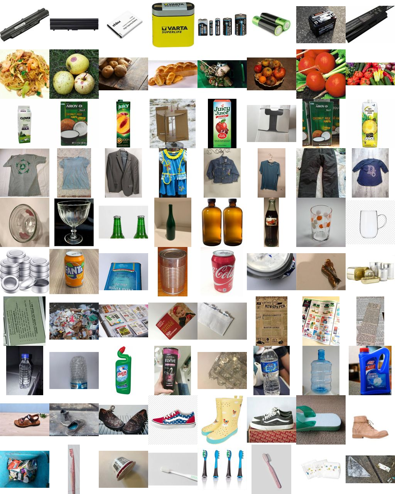
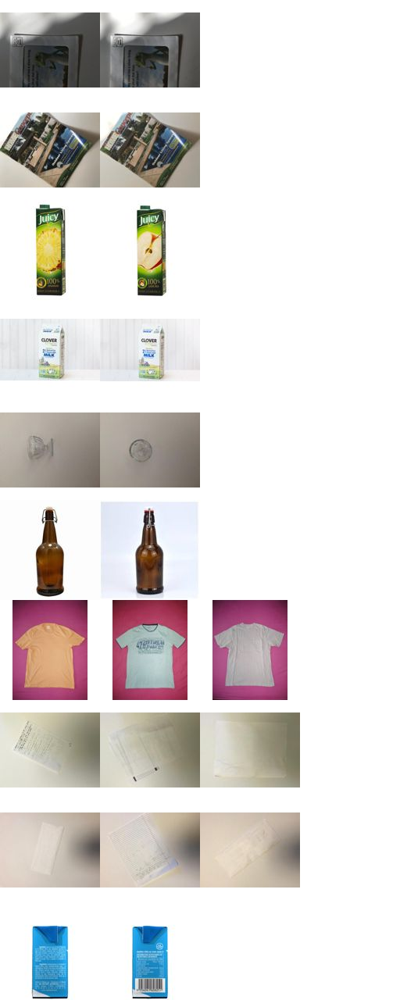

# Laporan Data (Tahap 0)

Dihasilkan oleh `python -m wastesorter.prepare` dari `data/raw/original`. Jangan diedit manual.

## Ringkasan

| Hal | Jumlah |
|---|---|
| File gambar ditemukan | 12259 |
| Rusak / tidak terbaca | 0 |
| Salinan byte-identik dibuang | 0 |
| Dibuang karena byte-identik di kelas berbeda | 0 |
| **Gambar di manifest** | **12259** |
| Grup hampir-sama (≥ 2 gambar) | 18 |
| Gambar di dalam grup tersebut | 49 |
| Grup terbesar | 11 |
| Grup yang melintasi kelas | 0 |
| Grup yang melintasi split | 0 |

Hampir-sama = korelasi thumbnail grayscale 32×32 ≥ 0.97, dikelompokkan secara transitif. Satu grup selalu masuk utuh ke satu split.

Keterbatasan: kriteria ini menangkap salinan, resize, dan kompresi ulang, tetapi tidak menangkap benda sama yang difoto ulang dari sudut lain, gambar yang dibalik atau di-crop, maupun foto berbeda dari sesi pemotretan yang sama (latar identik). Yang terakhir banyak di dataset ini dan tetap tersebar di ketiga split.

## Split per kelas

Target 70% / 15% / 15%, seed 42.

| Kelas | train | val | test | Total |
|---|---|---|---|---|
| battery | 529 | 114 | 113 | 756 |
| biological | 489 | 105 | 105 | 699 |
| cardboard | 988 | 212 | 211 | 1411 |
| clothes | 1324 | 284 | 284 | 1892 |
| glass | 1215 | 261 | 260 | 1736 |
| metal | 651 | 140 | 139 | 930 |
| paper | 935 | 201 | 200 | 1336 |
| plastic | 1118 | 240 | 239 | 1597 |
| shoes | 1014 | 218 | 217 | 1449 |
| trash | 317 | 68 | 68 | 453 |
| **total** | 8580 | 1843 | 1836 | 12259 |

## Ukuran gambar

|  | min | median | maks |
|---|---|---|---|
| lebar | 51 | 400 | 7786 |
| tinggi | 71 | 384 | 6283 |

## Contoh gambar

Satu baris per kelas, urut: battery, biological, cardboard, clothes, glass, metal, paper, plastic, shoes, trash.

## Contoh grup hampir-sama

10 grup acak, satu baris per grup (maks. 4 gambar).

